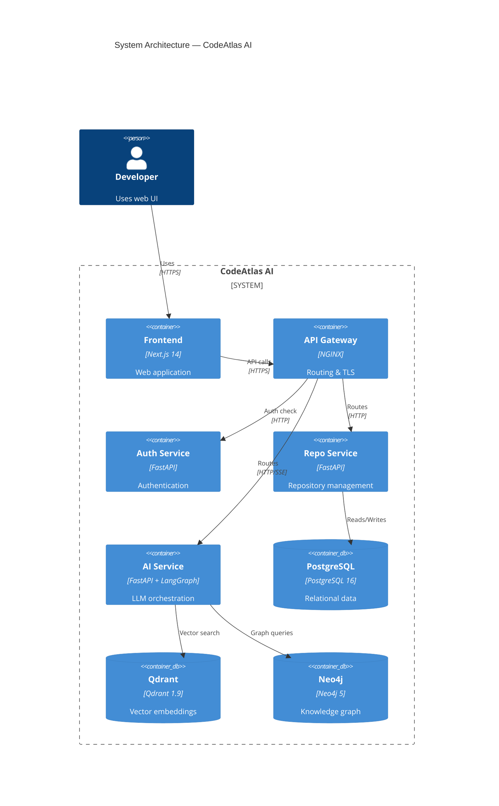
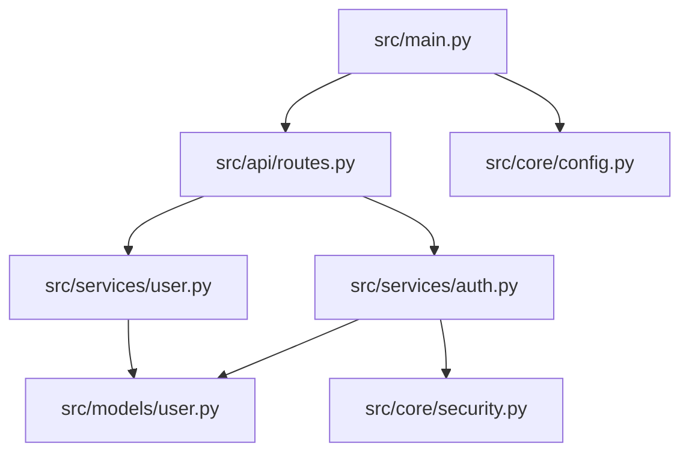
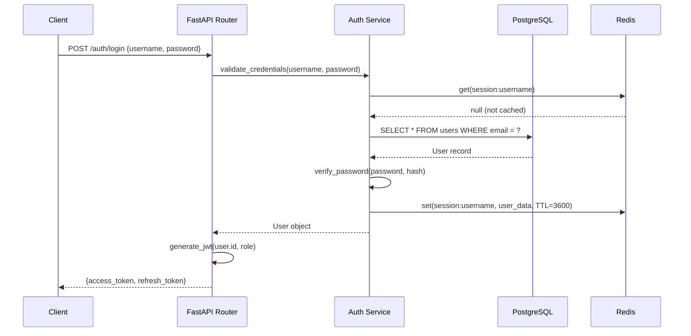
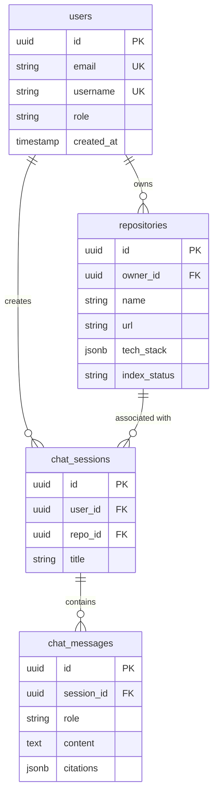

# 11 — Diagram Generator

## Overview

The Diagram Generator service produces architecture, dependency, sequence, ER, and deployment diagrams from the indexed knowledge graph and relational data. Diagrams are generated as source code (Mermaid, PlantUML, or D2), rendered to PNG/SVG, and stored in MinIO.

---

## Diagram Types

| Type | Source Data | Output Format |
|------|------------|---------------|
| System Architecture | Repo metadata, Docker Compose/K8s | Mermaid/C4 |
| Module Dependency | Neo4j import graph | Mermaid graph |
| Call Flow / Sequence | Neo4j call graph + AI | Mermaid sequence |
| ER Diagram | ORM models, SQL schema | Mermaid ER / PlantUML |
| Deployment Topology | Docker Compose / K8s manifests | Mermaid / D2 |
| Component Map | File classification data | Mermaid |
| Data Flow | AI inference from code | Mermaid |

---

## Generation Pipeline

```
┌──────────────────────────────────────────────────────────┐
│                  Diagram Service                          │
│                                                           │
│  ┌──────────────────────────────────────────────────┐    │
│  │            Diagram Request Handler                │    │
│  │  Input: {repo_id, diagram_type, options}          │    │
│  └─────────────────────┬────────────────────────────┘    │
│                        │                                  │
│         ┌──────────────┼───────────────────┐             │
│         │              │                   │              │
│  ┌──────▼──────┐ ┌─────▼──────┐  ┌────────▼────────┐   │
│  │  Data       │ │  Data      │  │  Data           │   │
│  │  Extractor  │ │  Extractor │  │  Extractor      │   │
│  │  (Neo4j)    │ │  (PG)      │  │  (MinIO/Files)  │   │
│  └──────┬──────┘ └─────┬──────┘  └────────┬────────┘   │
│         └──────────────┼───────────────────┘             │
│                        │                                  │
│  ┌─────────────────────▼────────────────────────────┐    │
│  │              Diagram Source Generator             │    │
│  │  (AI-assisted Mermaid/PlantUML/D2 synthesis)     │    │
│  └─────────────────────┬────────────────────────────┘    │
│                        │                                  │
│  ┌─────────────────────▼────────────────────────────┐    │
│  │              Renderer (Kroki API)                 │    │
│  │  Mermaid → PNG/SVG                                │    │
│  │  PlantUML → PNG/SVG                               │    │
│  │  D2 → PNG/SVG                                     │    │
│  └─────────────────────┬────────────────────────────┘    │
│                        │                                  │
│  ┌─────────────────────▼────────────────────────────┐    │
│  │              MinIO Storage                        │    │
│  │  repos/{repo_id}/artifacts/diagrams/              │    │
│  └──────────────────────────────────────────────────┘    │
└──────────────────────────────────────────────────────────┘
```

---

## Diagram 1: System Architecture

### Data Sources
- `docker-compose.yml` service definitions
- Kubernetes manifests
- Environment variables referencing external services
- AI inference for undocumented services

### Generated Mermaid (C4 Container Diagram)



---

## Diagram 2: Module Dependency

### Neo4j Query
```cypher
MATCH (f1:File)-[:IMPORTS]->(f2:File)
WHERE f1.repo_id = $repo_id
RETURN f1.path as source, f2.path as target, count(*) as weight
ORDER BY weight DESC
LIMIT 100
```

### Generated Mermaid



---

## Diagram 3: Sequence Diagram

### Input: Endpoint or function name
### Process: AI traces the call graph and generates sequence diagram



---

## Diagram 4: ER Diagram

### Data Sources
- SQLAlchemy/Tortoise/Prisma ORM model classes
- SQL migration files
- Pydantic models with relational hints

### Generated Mermaid ER



---

## Diagram 5: Deployment Topology

### Input: `docker-compose.yml` or Kubernetes manifests

### Generated D2

```d2
direction: right

internet -> nginx: HTTPS 443

nginx -> frontend: :3000
nginx -> gateway: :8000

gateway -> auth: :8001
gateway -> repo_service: :8002
gateway -> ai_service: :8004

repo_service -> postgres: :5432
repo_service -> redis: :6379
repo_service -> minio: :9000

ai_service -> qdrant: :6333
ai_service -> neo4j: :7687
ai_service -> ollama: :11434
```

---

## Renderer: Kroki

CodeAtlas uses [Kroki](https://kroki.io) (self-hosted) to render all diagram formats:

```python
async def render_diagram(source: str, format: str = "mermaid") -> bytes:
    response = await httpx.post(
        f"http://kroki:8000/{format}/png",
        content=source.encode(),
        headers={"Content-Type": "text/plain"}
    )
    return response.content
```

Supported via Kroki: Mermaid, PlantUML, D2, Graphviz, BPMN, C4, and more.

---

## Caching

Diagrams are cached and only regenerated when:
1. The repository is re-indexed
2. User explicitly requests regeneration
3. The source diagram data has changed (checksum comparison)
